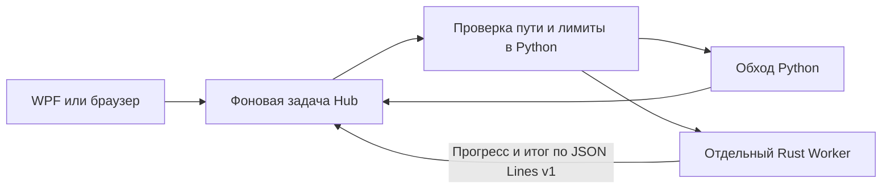

# Hub Pre-1.6.x · Rust Core

## Прототип

Phase 2 сохранена в `23e75cb`, исходный Python — в `86355737`. Разработка идёт в `codex/hub-1.6`. Стабильная ветка `main` и тег `v1.5.3.1` на GitHub указывают на `86355737`.



Python проверяет путь, исключения системных каталогов, глубину и размер обхода. На stdin отдельного процесса поступает одна строка JSON с версией протокола и параметрами. На stdout worker отдаёт `ready`, счётчики прогресса и один исход `result` или `scan_error`. Python подтверждает код выхода и формирует тот же результат, что у собственного обходчика. Ошибки протокола и падение worker отделены от штатных ошибок файловой системы. Rust читает метаданные, исключает reparse points и возвращает суммы логических байтов. Выдача файлов, удаление и корзина остаются в Python.

Python останавливает worker при отмене или спустя 30 секунд без сообщений, затем дожидается фактического выхода процесса. Отмена никогда не вызывает повторный обход. Если Windows ещё завершает заблокированную операцию, задача остаётся в состоянии отмены до освобождения процесса. Результат фоновой задачи публикуется после завершения.

Сборка worker на Windows из корня проекта. Команда ожидает установленный `cargo` и Windows toolchain. Для проверки использован Rust 1.100.0 `x86_64-pc-windows-gnu`.

```powershell
cargo build --locked --release --manifest-path rust/diskmap-worker/Cargo.toml
.venv/Scripts/python.exe -m unittest discover -v -s tests -p test_rust_diskmap.py
```

## Откуда взялись 366 и 273 мс

В обоих отчётах замерялся `nested-large/scan` из исходного Python, по 30 000 файлов размером 256 байт на томе C:. Версии Windows и Python, число логических CPU, стенд, границы таймера и метод подсчёта медианы совпадают по сохранённым данным. Это первые вызовы в отдельных процессах с пустым кэшем Hub. Кэш Windows явно не сбрасывался.

Исходная серия дала `366,54 / 378,81 / 365,65 / 328,37 / 281,98` мс. Phase 2 дала `273,42 / 283,66 / 272,33 / 273,00 / 266,14` мс. Исходную серию провели отдельно. В Phase 2 чередовали реализации на одной папке после её создания. Записей о состоянии кэша Windows, фоновой нагрузке и порядке выполнения каждой исходной пробы недостаточно, чтобы приписать разницу конкретной причине. Сценарии одинаковы по назначению, но серии отличаются условиями и не объединяются. [Первоначальная серия](../benchmarks/baseline-8635573.json) · [Парная серия Phase 2](../benchmarks/phase2-reference-8635573.json).

## Benchmark Lab · Phase 4

По 10 прогонов каждого движка на сценарий, порядок менялся после каждой тройки. Итого 310 прогонов на одних данных для сравниваемых движков. Windows 11, Python 3.13.17, 12 логических CPU, NTFS на C:. Rust Worker из `aa292d7`, Python из `8635573` и `23e75cb`. Замер Rust охватывает проверку пути, запуск, передачу запроса, чтение прогресса, подсчёт, завершение и обработку результата. В серии по 10 значений p95 практически упирается в максимум, поэтому за него не выдаю устойчивую оценку. Все отдельные значения и хеш worker есть в [результатах](../benchmarks/rust-aa292d7-windows.json).

| Сценарий | Файлов в результате | Время, мс Python 1 / Python 2 / Rust | CPU, мс Python 1 / Python 2 / Rust | Пик RAM, МиБ Python 1 / Python 2 / Rust* |
| --- | ---: | ---: | ---: | ---: |
| Малая вложенная папка | 2 000 | 20,02 / 19,76 / 30,59 | — | 24,90 / 24,99 / 35,36 |
| Малая вложенная, полный повторный | 2 000 | 18,29 / 19,56 / 27,94 | — | 24,91 / 24,96 / 35,40 |
| Большое вложенное дерево | 30 000 | 252,68 / 265,82 / 55,85 | 250,00 / 265,62 / 46,88 | 24,91 / 25,02 / 35,39 |
| Большое вложенное, полный повторный | 30 000 | 247,34 / 264,78 / 53,18 | 250,00 / 265,62 / 62,50 | 24,95 / 25,02 / 35,41 |
| Большое вложенное, кэш Hub | 30 000 | 1,74 / 1,98 / — | — | 24,94 / 24,63 / — |
| Широкая папка | 30 000 | 64,21 / 64,95 / 38,43 | 62,50 / 62,50 / 31,25 | 58,46 / 24,96 / 35,35 |
| Широкая папка, полный повторный | 30 000 | 62,22 / 63,53 / 35,50 | 62,50 / 62,50 / 15,62 | 58,46 / 24,97 / 35,40 |
| Широкая папка, полный список | 30 000 | 838,60 / 667,51 / — | 843,75 / 671,88 / — | 56,43 / 55,81 / — |
| 55 уровней | 1 100 | 7,92 / 7,28 / 31,90 | — | 26,12 / 25,31 / 35,70 |
| 12 каталогов без доступа | 1 000 | 5,98 / 4,77 / 29,67 | — | 25,87 / 25,03 / 35,43 |
| Файлы разного размера | 35 000 | 46,29 / 60,59 / 41,12 | 46,88 / 62,50 / 31,25 | 25,40 / 24,99 / 35,40 |

\* Для гибридного варианта это сумма двух пиков и верхняя граница совокупного рабочего набора. Отдельный процесс Rust достигал примерно 9,5 МиБ. Суммарное CPU-время — Python плюс Rust с учётом запуска. У коротких операций системный счётчик даёт слишком крупный шаг. Процент нагрузки на одно логическое ядро сохранён в JSON.

Во всех прогонах сошлись количества файлов, логические байты, структура сводки и пути ошибок. На наборе разной длины учтено 283 284 932 байта. При отказах NTFS во всех движках учтён 1 000 доступных файлов и 12 отказов на папках, за которыми находятся 1 200 недоступных файлов. Кэш Windows не сбрасывали. Для полного повтора приложение явно обходит дерево ещё раз, для кэшированного сценария измеряется попадание в кэш Hub.

Rust прошёл порог 20% относительно Phase 2 на трёх больших наборах. Медиана по вложенному набору улучшилась на 79%, по широкой папке на 41%, по набору с разными размерами на 32%. Старт процесса занимает около 22–25 мс. Короткие операции получают плюс 8–25 мс, и пиковая память растёт примерно на 10 МиБ относительно Python Phase 2. Эти результаты поддерживают экспериментальный выпуск с Python по умолчанию.

Воспроизведение. Сначала собери worker из указанного коммита и подготовь две временные копии каталога `tools` через `git archive` для `8635573` и `23e75cb`. Используй путь к новому JSON.

```powershell
.venv/Scripts/python.exe -m benchmarks.rust_disk_map `
  --original dist/core-src-8635573 --optimized dist/core-src-23e75cb --temp-dir dist `
  --revisions 86355737def0d85b827995eaaad3247d18273b50 23e75cb3929eaa28cdef4f78d3475bf25d2474ed aa292d79b08c9f4df4692f40fc24ef33a73cbffb `
  --output dist/rust-aa292d7-reproduced.json
```

## Совместимость Windows · Phase 5

Сравнивались полный ответ Python и Rust, стабильные суммы и имена, лимиты, длинные пути свыше 260 символов, Unicode, настоящие junction с циклом и повторным путём, ACL NTFS и корень временного тома. В отдельном тесте файл изменён и другой удалён после сообщения о прогрессе на дереве из 30 000 файлов. Первый итог мог отразить данные до или после изменения. Следующий вызов обоих движков дал ровно тот же свежий результат.

В первой серии Windows-проверок нашли различие в пунктуации ошибок NTFS. Адаптер приведён к формату Python. Также исправили аргументы `mklink` в тесте и увеличили число каталогов в сценарии с изменением файла, чтобы тест успевал получить промежуточный прогресс. Повторная серия прошла. Реальные символьные ссылки требуют дополнительного права Windows, поэтому этот сценарий отмечен пропуском.

## Переключатель · Phase 6

«Настройки → Эксперименты → Rust Core для карты диска» сохраняет выбор в `preferences.json`. Браузерный интерфейс изменяет ту же настройку своего локального сервера. Новые профили используют Python. Перезапуск не требуется. Каждый расчёт фиксирует выбранный движок при старте. При аварии или повреждении worker Hub сначала завершает дочерний процесс, сообщает о сбое и один раз запускает Python в том же задании. При отмене и штатных ошибках доступа повтора нет. Незавершённый результат worker не становится итогом. Чтобы вернуться к Python, отключи эксперимент и запусти следующий расчёт.

## Поставка · Phase 7

`windows/build.ps1` собирает worker командой Cargo с `Cargo.lock` и упаковывает его в `bin` внутри `Hub.exe`. У проверенного x64 worker только системные импорты Windows. Бинарник в архиве PyInstaller совпал с собранным побайтно. Установщик Inno Setup 6.7.4 и ZIP собраны для 1.6.0.

На этой Windows 11 выполнены чистая установка 1.6.0 и обновление с 1.5.3.1 до 1.6.0. Для каждого сценария использован отдельный тестовый каталог и профиль. Заметка старой версии и выбранный движок сохранились. В приложении с системным `PATH` проверены запуск Rust без toolchain, возврат к Python и отработка отсутствующего и повреждённого worker. В первом прогоне восьмисекундного ожидания завершения старого приложения не хватило. Повтор с двадцатисекундным ожиданием прошёл с ответами API о завершении в обеих версиях.

Контрольные суммы SHA-256 локальных артефактов сборки.

| Артефакт | SHA-256 |
| --- | --- |
| `Hub-Setup-Windows-x64.exe` | `A7BBCEFEC71079E7F48998D8C10AA61FA25D38DDEDBD3AE79522798CDCB986F8` |
| `Hub-Windows-x64.zip` | `AE08BECF65279D2C1462B367BF1B265408CEBA8F4934C0246F7B15289764E83E` |

По SMB на loopback проверены сопоставимый итог Python и Rust для UNC и подключённого сетевого диска, Unicode, отказ для недоступного сетевого пути и защита корня сетевого диска. Тесты обращались к временной папке в рабочем каталоге. Отдельный сетевой сервер и высокий сетевой лаг не проверялись. Если сетевой вызов блокирует Python fallback, его отмена кооперативная. Для Rust применяется остановка процесса с ожиданием выхода.

## Регрессия и статус · Phases 8–9

**RELEASE CANDIDATE.** Порог производительности, совпадение результатов, прогресс, отмена, fallback, регрессия, сборка, установка и обновление подтверждены. Остались запуск на отдельно развёрнутой Windows и четыре интеграционных проверки с реальными символьными ссылками. Без отдельного SMB-сервера проверён локальный сетевой диск. Ветка 1.5.x и опубликованный релиз не менялись.

- Python — 228 прошли из 232. На финальном прогоне ошибок и провалов нет.
- Node.js — 93 из 93. Проверены сохранение браузерного переключателя и показ подтверждения отмены только после завершения задания.
- WPF с локальным HTTP — переключение в настройках, результат Rust, предупреждение о возврате к Python, завершение Rust при уходе со страницы, прогресс Python и подтверждение его остановки.

Четыре пропуска из-за Windows `WinError 1314` и отсутствия права создавать символьные ссылки:

| Проверка | Что осталось без проверки |
| --- | --- |
| `test_bigfiles.BigFilesTestCase.test_links_are_not_listed_or_authorized` | Символьная ссылка при работе «Больших файлов» |
| `test_diskmap.DiskMapActionsTestCase.test_links_are_not_listed_or_authorized` | Символьная ссылка при выдаче списка Python Disk Map |
| `test_rust_diskmap.RustDiskMapTests.test_real_symlink` | Реальные символьные ссылки на файл и каталог в Rust |
| `test_trash.TrashTestCase.test_symlinks_are_refused_by_trash` | Отказ корзины для реальной символьной ссылки |

### Изменённые компоненты

| Область | Файлы |
| --- | --- |
| Rust Worker | `rust/diskmap-worker/Cargo.toml`, `Cargo.lock`, `src/main.rs`, `.gitignore` |
| Python и HTTP | `tools/diskmap.py`, `tools/rust_diskmap.py`, `tools/jobs.py`, `tools/preferences.py`, `server.py` |
| WPF и браузер | `native/file_pages.py`, `native/widgets.py`, `native/ui.py`, `web/tools/diskmap.js`, `web/index.html`, `web/app.js` |
| Поставка | `windows/build.ps1`, `README.md` |
| Проверки | `tests/test_rust_diskmap.py`, `tests/test_diskmap_ui.cjs`, `tests/test_settings_ui.cjs` |
| Замеры и отчёт | `benchmarks/disk_map.py`, `benchmarks/rust_disk_map.py`, `benchmarks/rust-aa292d7-windows.json`, `docs/pre-1.6-rust.md` |
