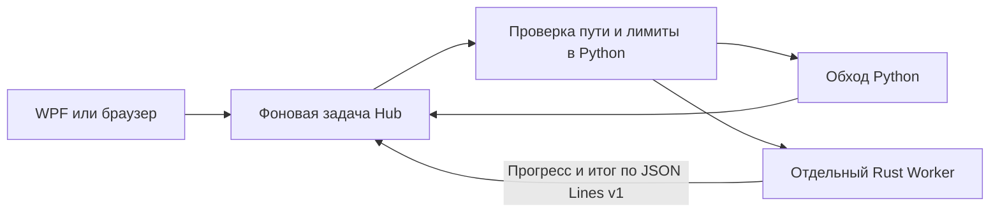

# Hub Pre-1.6.x · Rust Core

## Прототип

Phase 2 сохранена в `23e75cb`, исходный Python — в `86355737`. Разработка идёт в `codex/hub-1.6`. Стабильная ветка `main` и тег `v1.5.3.1` на GitHub указывают на `86355737`.



Python проверяет путь, исключения системных каталогов, глубину и размер обхода. На stdin отдельного процесса поступает одна строка JSON с версией протокола и параметрами. На stdout worker отдаёт `ready`, счётчики прогресса и один исход `result` или `scan_error`. Python подтверждает код выхода и формирует тот же результат, что у собственного обходчика. Ошибки протокола и падение worker отделены от штатных ошибок файловой системы. Rust читает метаданные, исключает reparse points и возвращает суммы логических байтов. Выдача файлов, удаление и корзина остаются в Python.

Python останавливает worker при отмене или спустя 30 секунд без сообщений, затем дожидается фактического выхода процесса. Отмена никогда не вызывает повторный обход. Если Windows ещё завершает заблокированную операцию, задача остаётся в состоянии отмены до освобождения процесса. Результат фоновой задачи публикуется после завершения.

Сборка worker на Windows из корня проекта. Команда ожидает установленный `cargo` и Windows toolchain. Для проверки использован Rust 1.100.0 `x86_64-pc-windows-gnu`.

```powershell
cargo build --locked --release --manifest-path rust/diskmap-worker/Cargo.toml
.venv/Scripts/python.exe -m unittest discover -v -s tests -p test_rust_diskmap.py
```

## Откуда взялись 366 и 273 мс

В обоих отчётах замерялся `nested-large/scan` из исходного Python, по 30 000 файлов размером 256 байт на томе C:. Версии Windows и Python, число логических CPU, стенд, границы таймера и метод подсчёта медианы совпадают по сохранённым данным. Это первые вызовы в отдельных процессах с пустым кэшем Hub. Кэш Windows явно не сбрасывался.

Исходная серия дала `366,54 / 378,81 / 365,65 / 328,37 / 281,98` мс. Phase 2 дала `273,42 / 283,66 / 272,33 / 273,00 / 266,14` мс. Исходную серию провели отдельно. В Phase 2 чередовали реализации на одной папке после её создания. Записей о состоянии кэша Windows, фоновой нагрузке и порядке выполнения каждой исходной пробы недостаточно, чтобы приписать разницу конкретной причине. Сценарии одинаковы по назначению, но серии отличаются условиями и не объединяются. [Первоначальная серия](../benchmarks/baseline-8635573.json) · [Парная серия Phase 2](../benchmarks/phase2-reference-8635573.json).
